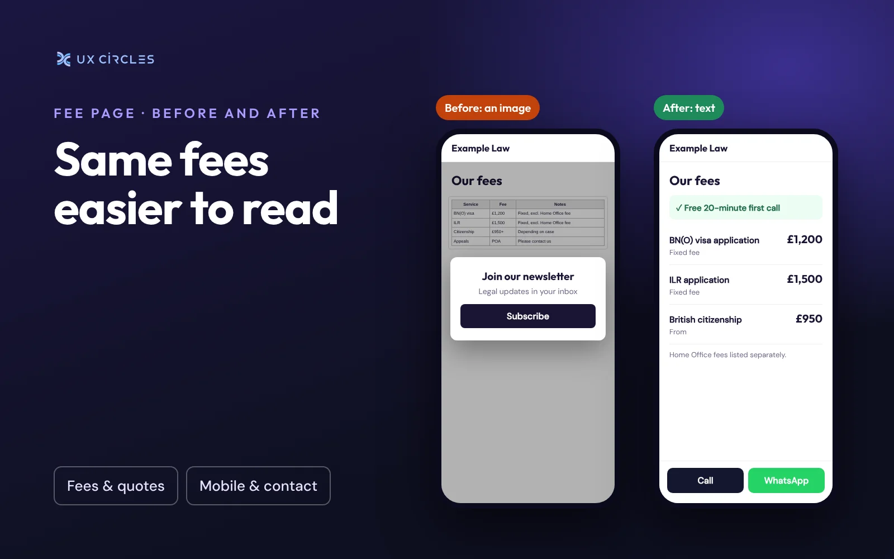

Picture a client on the bus, comparing three firms on their phone. Your fees page loads, and the prices are inside a picture of a table. The text is tiny. They pinch to zoom, a newsletter pop-up slides over it, and they close the tab.

Posting a fee table as an image is one of the most common things I see on websites for small law firms, accountants and estate agents. It usually happens for a good reason: the table was made in Word or Excel, and a screenshot was the quickest way to get it online. But it quietly costs you enquiries.

## Why an image works against you

- <b>It is hard to read on a phone.</b> Most clients first look at your site on a phone. An image of a wide table shrinks to fit the screen, so the numbers become too small to read without zooming.
- <b>Search engines can't reliably read it.</b> If someone searches for "BN(O) visa solicitor fixed fee", your prices can't help you appear, because the text isn't really there.
- <b>Screen readers can't read it.</b> A client with a visual impairment hears "image" and nothing else, unless someone wrote a full description.
- <b>Pop-ups make it worse.</b> A newsletter or cookie box often sits on top of the image, and on a small screen there is nowhere to scroll it away. Google has also said that pop-ups covering the main content on mobile can count against a page.
- <b>It goes out of date.</b> When a fee changes, someone has to remake and re-upload the picture. Often nobody does, and the old price stays online.

## What to do instead

Put your fees on the page as plain text. It doesn't need to be fancy. A simple list works well on a phone:

- Name of the service
- What is included
- Your fee, and whether it is fixed or "from"
- Third-party costs listed separately, such as government fees or disbursements

If your table has many columns, split it into short sections, one per service. Clients rarely compare every service at once; they look for the one they need.

Two small changes make a big difference:

1. <b>Put your free consultation at the top of the fees page,</b> and on your homepage. If you offer a free first call, it is often the best reason to contact you. Don't leave it at the bottom.
2. <b>Add a Call or WhatsApp button next to the fees.</b> The moment a client sees a price they are comfortable with is the moment they are most likely to get in touch.

## A five-minute check

- [ ] Open your fees page on your phone. Can you read every price without zooming?
- [ ] Try selecting a price with your finger. If you can't, it is an image.
- [ ] Does any pop-up cover the fees? Can you close it easily?
- [ ] Is your free consultation visible without scrolling?
- [ ] Are the prices the same as the ones you quote today?

<i>Chun-Chuan Lin is a product designer with 14 years of experience and the founder of UX CIRCLES, a web design studio in London.</i>
