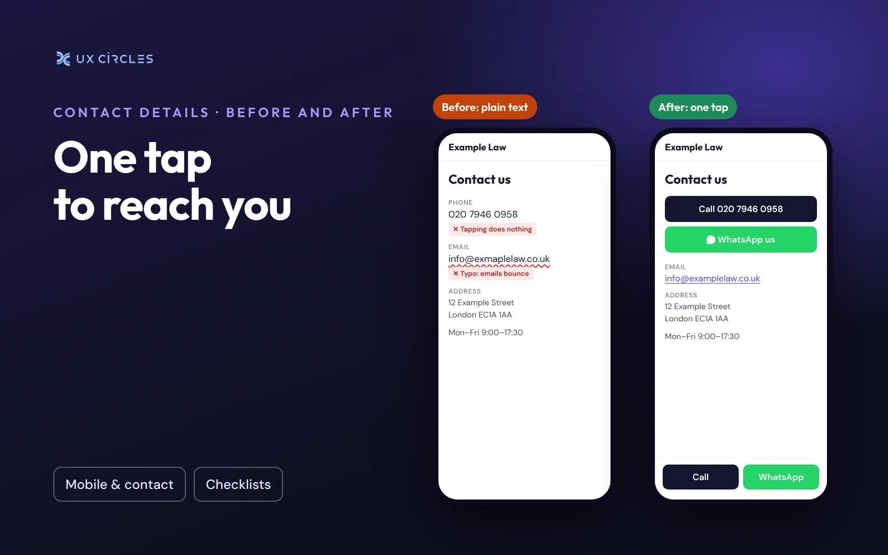

When a client decides to contact you, they want it to take one tap. If your number is plain text, they have to copy it, switch apps and paste it. If the link dials the wrong number, they may assume you have closed. Either way, a warm lead goes to the next firm on their list.

Contact details sound like the easiest part of a website, but they break more often than you would think. These are the problems I see most on small firms' websites.

## Common problems

- <b>The number isn't a link.</b> On a phone, a number written as plain text can't be tapped. The client has to copy it by hand.
- <b>The link dials a different number.</b> The visible number and the number behind the link can drift apart, for example after changing phone provider. The page shows one number; tapping it calls another.
- <b>The international format is wrong.</b> A link like +44 020… adds an extra zero, and the call fails. In international format, the 0 after +44 is dropped.
- <b>The email address has a typo.</b> One extra letter in the footer, and anyone who copies it reaches nobody. You won't notice, because you never email yourself from your own website.
- <b>WhatsApp is missing or hidden.</b> Many Hong Kong and Taiwanese clients prefer WhatsApp to a phone call. If it is only mentioned on the contact page, many won't find it.
- <b>Different pages show different details.</b> An old address on one page, a new one on another, and a client may go to the wrong door.

## How to fix it

1. <b>Make every phone number a link.</b> Your web designer can set it up so that tapping it opens the phone app. Use the international format, for example +44 20 7946 0000, without the extra 0.
2. <b>Add a WhatsApp link</b> that opens a chat directly. If you use WhatsApp Business, you can also set a short greeting message.
3. <b>Show Call and WhatsApp buttons on every page on mobile,</b> fixed at the bottom of the screen, so they are always within reach.
4. <b>Keep your contact details in one place</b> in your website builder, so a change updates every page at once.
5. <b>Test it yourself every few months,</b> and after any change of number, address or email.

## A five-minute check

- [ ] On your phone, tap every phone number on your website. Does it call the right number?
- [ ] Tap your email address. Does it open an email to the right address?
- [ ] Copy the email address from the footer and send yourself a test message.
- [ ] Can a client reach you on WhatsApp in one tap?
- [ ] Is your address the same on the homepage, footer and contact page?

<i>Chun-Chuan Lin is a product designer with 14 years of experience and the founder of UX CIRCLES, a web design studio in London.</i>
