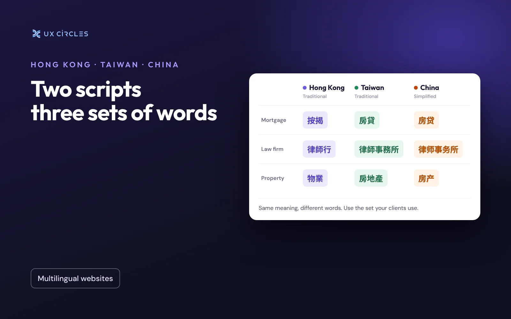

"We have a Chinese version" can mean very different things to different clients. A Hong Kong family, a Taiwanese professional and a student from mainland China all read Chinese, but not in the same way. Choosing the wrong version, or mixing them, quietly tells clients that the website wasn't written for them.

## Two scripts, three sets of words

- <b>Traditional Chinese</b> is used in Hong Kong, Taiwan and Macau.
- <b>Simplified Chinese</b> is used in mainland China, Singapore and Malaysia.

The script is only half of it. Everyday words also differ, especially in areas your clients care about:

- Mortgage: 按揭 in Hong Kong, 房貸 in Taiwan, 房贷 in mainland China
- Law firm: 律師行 or 律師樓 in Hong Kong, 律師事務所 in Taiwan, 律师事务所 in mainland China
- Property: 物業 in Hong Kong, 房地產 or 不動產 in Taiwan, 房产 in mainland China

A Hong Kong client reading Taiwanese wording will understand it, but it won't feel like it was written for them. The same goes the other way.

## How to choose

1. <b>Look at who your clients are today.</b> If most are Hong Kong families on BN(O) visas, Traditional Chinese with Hong Kong wording should come first.
2. <b>Add a second version only if you serve that group.</b> Many firms work with both Hong Kong and mainland clients. In that case, keep two separate versions rather than one mixed page.
3. <b>Think about Cantonese carefully.</b> Written Cantonese (with words like 嘅 and 咩) feels warm and local, and works well for social media. For fees, terms and legal information, standard written Chinese with Hong Kong vocabulary usually reads as more professional.

## Why automatic conversion isn't enough

Tools that convert Simplified to Traditional change the characters, but not the words. A converted page may use mainland vocabulary in Traditional characters, which reads oddly to a Hong Kong client. Some characters also have more than one Traditional form, so conversion can produce the wrong one.

The most common sign of this is a page that mixes both scripts: a Traditional Chinese page with a few Simplified characters in the footer or menu. Clients notice, and it looks careless.

## Small details that help

- Label your language switcher in each language's own script, for example "English · 繁中 · 简中", so each reader recognises theirs.
- Tell search engines which version is which, so a Hong Kong client searching in Traditional Chinese finds the right page.
- Keep names, phone numbers and addresses identical across all versions.

## A five-minute check

- [ ] Which group do most of your clients belong to? Does your Chinese version match them?
- [ ] Scan the Chinese pages for any characters in the other script, especially in menus and footers.
- [ ] Do key terms like mortgage, property and law firm use your clients' words?
- [ ] Is the language switcher easy to find on a phone?

<i>Chun-Chuan Lin is a product designer with 14 years of experience and the founder of UX CIRCLES, a web design studio in London.</i>
