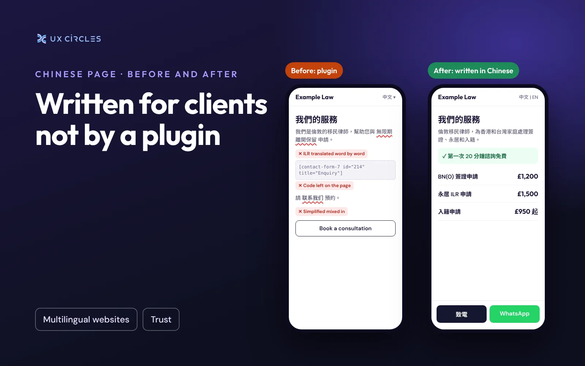

Many firms that serve Chinese-speaking clients add a translation button to their website. It is quick and cheap, and it looks like the problem is solved. But a client who reads the Chinese version often gets a very different impression from the one you intended.

## What a translation plugin gets wrong

- <b>Legal and financial terms come out wrong.</b> Machine translation picks a common meaning, not the one used in your field. A term like "conveyancing" or "indefinite leave to remain" can come out as something no Hong Kong or Taiwanese client would recognise.
- <b>It translates things it shouldn't.</b> Names, addresses, account IDs and form labels can all get translated. I have seen a WeChat ID turned into words in another language, so anyone who copied it couldn't find the firm.
- <b>Code shows up on the page.</b> When a plugin is set up incorrectly, visitors can see raw code such as a shortcode in square brackets at the top of the page. It looks like a broken website.
- <b>It may not help clients find you.</b> Some plugins only translate the page in the visitor's browser, so there is no Chinese page for search engines to find. A client searching in Chinese may never see you.
- <b>It doesn't sound like you.</b> Clients choosing a solicitor or accountant are looking for someone they can trust. Stiff, machine-made Chinese suggests the firm doesn't really work in Chinese, even when it does.

## When real Chinese pages are worth it

You don't need to translate your whole website. Start with the pages that decide whether a client contacts you:

1. <b>Homepage:</b> who you are, who you help, and how to contact you.
2. <b>Your main services:</b> for example, BN(O) visas, property, or tax returns.
3. <b>Fees:</b> clear prices in Chinese build more trust than anything else.
4. <b>Contact:</b> with WhatsApp, phone and address, written correctly.

Write these in Chinese, not just translate them. Use the words your clients use. A Hong Kong client says 按揭 for mortgage; a Taiwanese client says 房貸. If your team speaks Chinese, ask them to read every page before it goes live.

## A five-minute check

- [ ] Switch your website to Chinese. Would you be comfortable sending this page to a client?
- [ ] Are names, phone numbers and IDs still correct in the Chinese version?
- [ ] Is any code or English placeholder text visible?
- [ ] Search for your main service in Chinese. Does your website appear?
- [ ] Does the Chinese version have a clear way to contact you?

<i>Chun-Chuan Lin is a product designer with 14 years of experience and the founder of UX CIRCLES, a web design studio in London.</i>
