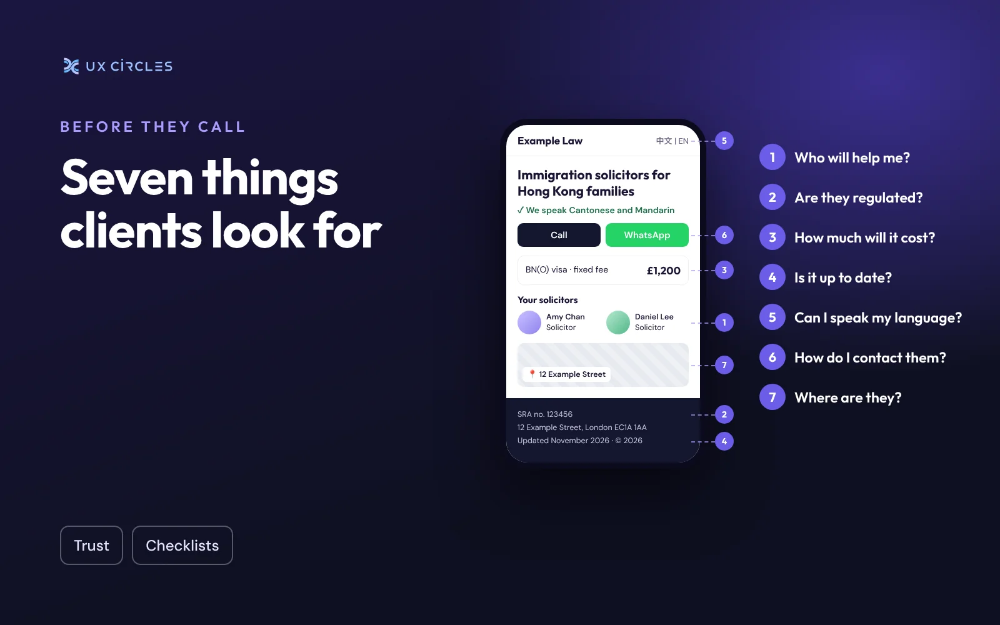

Choosing a solicitor, accountant or mortgage adviser is a high-stakes decision. Clients are trusting you with their visa, their savings or their home. So before they call, they look for reassurance, usually on their phone and usually in a minute or two.

I spent years designing products for a wealth management platform, where trust decided everything. The same pattern applies to a small firm's website: people aren't reading every word. They are scanning for a few signs that tell them it is safe to get in touch.

## Seven things clients look for

1. <b>Who will help me?</b> Names, photos and qualifications of the people who will handle the case. A page with only "our team" and no faces feels anonymous.
2. <b>Are they regulated?</b> Your regulator and registration number, shown clearly, for example in the footer and on your About page. Clients may not know the details, but they notice whether it is there.
3. <b>How much will it cost?</b> Clear fees, or at least how you charge. Hidden prices make people assume the worst.
4. <b>Is the information up to date?</b> Outdated visa names, old fees or a copyright year from years ago suggest nobody looks after the website, and maybe the firm as well.
5. <b>Can I speak my language?</b> If you serve Chinese-speaking clients, say so on the first screen, and make sure the Chinese pages are real and correct.
6. <b>How do I contact them?</b> A Call or WhatsApp button that works with one tap, and a free consultation that is easy to find.
7. <b>Where are they?</b> An address that is the same on every page, and a map. Clients who plan to visit want to be sure they will find the right door.

## Where to put them

Most of these should be visible on your homepage on a phone, without much scrolling:

- First screen: who you help, the languages you speak, and a contact button
- Next: your main services with a short line on fees
- Then: the people, with photos and qualifications
- Footer: regulator details, address and contact information

## A five-minute check

Ask a friend who hasn't seen your website to open it on their phone. Give them one minute, then ask:

- [ ] Who would handle my case?
- [ ] Is this firm regulated?
- [ ] Roughly how much would it cost?
- [ ] Can I speak Chinese with them?
- [ ] How would I contact them right now?

Any question they can't answer is something to move higher up the page.

<i>Chun-Chuan Lin is a product designer with 14 years of experience and the founder of UX CIRCLES, a web design studio in London.</i>
