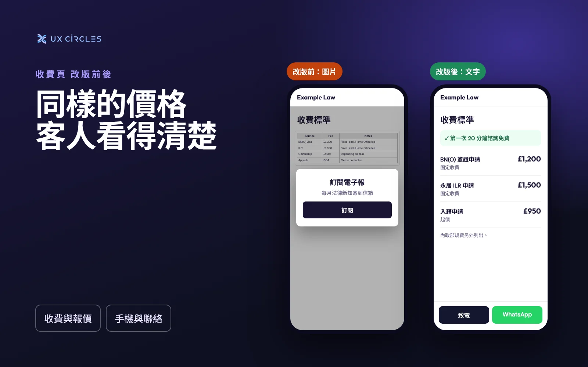

想像一位客人在公車上，用手機比較三家事務所。打開你的收費頁，價格是一張表格的截圖，字非常小。他用兩隻手指放大，電子報的彈窗剛好跳出來蓋住表格，他就把頁面關掉了。

把收費表做成圖片，是我在小型律師事務所、會計師事務所和地產代理網站上最常看到的問題之一。原因通常很合理：表格是用 Word 或 Excel 做的，截圖上傳最快。但它會在你沒察覺的情況下，讓你少了很多詢問。

## 用圖片有什麼問題

- <b>手機上看不清楚</b>：大部分客人第一次看你的網站是用手機。一張寬表格縮到螢幕大小，數字小到不放大就看不見。
- <b>搜尋引擎讀不到</b>：有人搜尋「BN(O) 簽證 律師 固定收費」，你的價格幫不上忙，因為那些文字其實不存在於網頁上。
- <b>螢幕閱讀器讀不到</b>：視障客人只會聽到「圖片」兩個字，除非有人另外寫了完整的文字說明。
- <b>彈窗讓情況更糟</b>：電子報或 Cookie 的提示框常常蓋在圖片上面，手機螢幕小，連捲開的空間都沒有。Google 也表示過，手機上蓋住主要內容的彈窗，可能會對網頁不利。
- <b>容易過期</b>：費用一調整，就要重做、重傳一張圖。很多時候沒人記得，舊價格就一直掛在網上。

## 改成這樣做

把收費直接寫成網頁上的文字，不需要花俏。手機上最好讀的是簡單的清單：

- 服務名稱
- 包含哪些內容
- 你的收費，標明是固定收費還是「起價」
- 第三方費用另外列出，例如政府規費或代墊費用

如果表格欄位很多，就拆成幾個小段落，一項服務一段。客人很少一次比較所有服務，他們只想找到自己需要的那一項。

兩個小改動，效果很大：

1. <b>把免費諮詢放在收費頁最上方</b>，首頁也要有。如果你提供免費的第一次通話，這往往是客人聯絡你的最好理由，不要放在頁面最下面。
2. <b>在收費旁邊加上「致電」或 WhatsApp 按鈕</b>：客人看到能接受的價格那一刻，就是最可能聯絡你的時候。

## 五分鐘自我檢查

- [ ] 用手機打開收費頁，不放大能看清楚每個價格嗎？
- [ ] 用手指試著選取一個價格。選不起來，就是圖片。
- [ ] 有沒有彈窗蓋住收費？能不能輕鬆關掉？
- [ ] 不用往下捲，就看得到免費諮詢嗎？
- [ ] 網站上的價格，和你現在實際的報價一樣嗎？

<i>林俊全（Chun-Chuan Lin）是有 14 年經驗的產品設計師，也是倫敦網頁設計工作室 UX CIRCLES 的創辦人。</i>
