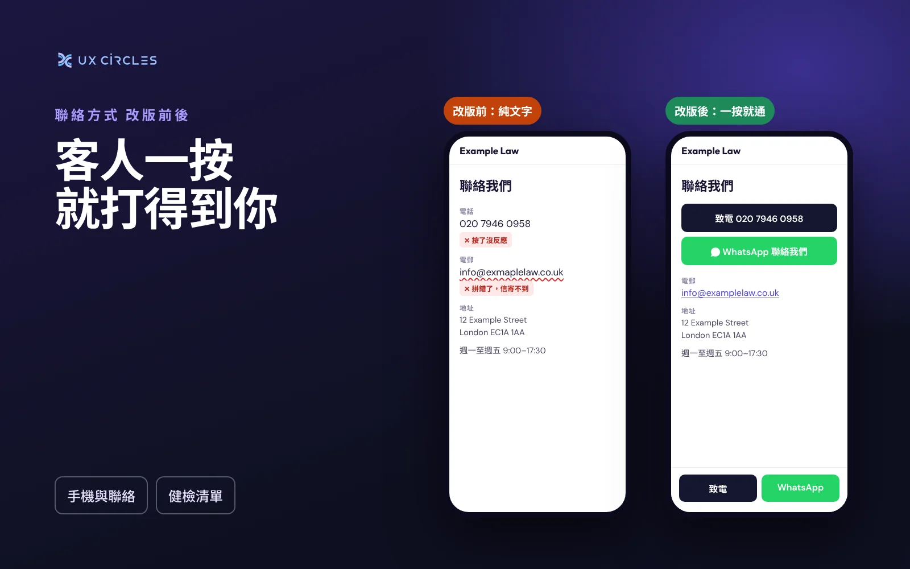

客人決定要聯絡你的時候，希望一按就能做到。如果電話號碼只是文字，他得先複製、切換程式、再貼上。如果按下去撥到別的號碼，他可能以為你已經不營業了。不管是哪一種，一個本來有興趣的客人，就這樣轉向名單上的下一家。

聯絡資訊聽起來是網站上最簡單的部分，但出錯的機率比你想像得高。以下是我在小型事務所網站上最常看到的問題。

## 常見問題

- <b>號碼不是連結</b>：手機上，寫成純文字的號碼不能點，客人只能自己手動複製。
- <b>按下去撥到另一個號碼</b>：網頁上顯示的號碼和連結背後的號碼可能不一致，例如換過電話公司之後。畫面寫的是一個號碼，按下去打的是另一個。
- <b>國際格式寫錯</b>：像 +44 020… 這樣的連結多了一個 0，電話會打不通。用國際格式時，+44 後面的 0 要拿掉。
- <b>電子信箱有錯字</b>：頁尾的信箱多一個字母，複製這個地址寫信的人就聯絡不到你。你自己不會發現，因為你從來不會從自己的網站寫信給自己。
- <b>沒有 WhatsApp，或藏得很深</b>：很多香港和台灣的客人比起打電話，更習慣用 WhatsApp。如果只寫在聯絡頁，很多人根本找不到。
- <b>不同頁面寫的資料不一樣</b>：這一頁是舊地址，那一頁是新地址，客人可能就跑錯地方。

## 怎麼改

1. <b>每個電話號碼都設成連結</b>：請網頁設計師設定成一按就開啟電話。使用國際格式，例如 +44 20 7946 0000，不要多一個 0。
2. <b>加上 WhatsApp 連結</b>，一按就直接開啟對話。如果你用 WhatsApp Business，還可以設定簡短的歡迎訊息。
3. <b>手機版每一頁都放「致電」和 WhatsApp 按鈕</b>，固定在畫面底部，隨時按得到。
4. <b>聯絡資訊集中在網站後台的同一個地方管理</b>，改一次，所有頁面一起更新。
5. <b>每隔幾個月自己測試一次</b>，換號碼、換地址或換信箱之後也要測。

## 五分鐘自我檢查

- [ ] 用手機按網站上的每一個電話號碼，撥出去的號碼對嗎？
- [ ] 按一下電子信箱，會開啟寫給正確地址的信件嗎？
- [ ] 從頁尾複製信箱地址，寄一封測試信給自己。
- [ ] 客人能一按就用 WhatsApp 聯絡你嗎？
- [ ] 首頁、頁尾和聯絡頁的地址都一樣嗎？

<i>林俊全（Chun-Chuan Lin）是有 14 年經驗的產品設計師，也是倫敦網頁設計工作室 UX CIRCLES 的創辦人。</i>
