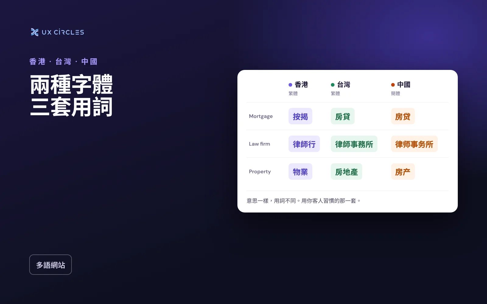

「我們有中文版」，對不同的客人來說意思差很多。香港家庭、台灣上班族和來自中國大陸的留學生都讀中文，但讀的方式不一樣。選錯版本，或把兩種混在一起，等於在告訴客人：這個網站不是寫給你的。

## 兩種字體 三套用詞

- <b>繁體中文</b>：香港、台灣和澳門使用。
- <b>簡體中文</b>：中國大陸、新加坡和馬來西亞使用。

字體只是一半，日常用詞也不同，尤其是客人最在意的領域：

- 房屋貸款：香港說「按揭」，台灣說「房貸」，中國大陸說「房贷」
- 律師事務所：香港說「律師行」或「律師樓」，台灣說「律師事務所」，中國大陸說「律师事务所」
- 房地產：香港說「物業」，台灣說「房地產」或「不動產」，中國大陸說「房产」

香港客人讀台灣用語看得懂，但不會覺得這是寫給自己的，反過來也一樣。

## 怎麼選

1. <b>看你現在的客人是誰</b>：如果大部分是持 BN(O) 簽證的香港家庭，就先做繁體中文、用香港用語。
2. <b>真的服務另一群人，再加第二個版本</b>：很多事務所同時服務香港和中國大陸客人。這時候要分成兩個獨立版本，不要混在同一頁。
3. <b>廣東話要想清楚再用</b>：口語的廣東話寫法（例如「嘅」「咩」）親切、有在地感，很適合社群貼文。但收費、條款和法律資訊，用書面中文配上香港用語，通常看起來更專業。

## 為什麼只靠繁簡轉換不夠

繁簡轉換工具只換字，不換詞。轉出來的頁面可能是「繁體字配大陸用語」，香港客人讀起來很奇怪。有些簡體字對應不只一個繁體字，轉換時也可能轉錯。

最常見的後果，是同一頁兩種字體混用：繁體頁面的選單或頁尾，夾著幾個簡體字。客人看得出來，會覺得不夠用心。

## 幾個有幫助的小細節

- 語言切換選單用各語言自己的寫法，例如「English · 繁中 · 简中」，讓每位讀者一眼認出自己的版本。
- 告訴搜尋引擎每個版本是哪一種語言，香港客人用繁體搜尋時，才會找到對的頁面。
- 每個版本的人名、電話和地址都要完全一致。

## 五分鐘自我檢查

- [ ] 你的客人大多來自哪裡？中文版符合他們的習慣嗎？
- [ ] 檢查中文頁面有沒有另一種字體的字，特別是選單和頁尾。
- [ ] 按揭、物業、律師行這類關鍵詞，用的是客人的說法嗎？
- [ ] 用手機看，語言切換選單容易找到嗎？

<i>林俊全（Chun-Chuan Lin）是有 14 年經驗的產品設計師，也是倫敦網頁設計工作室 UX CIRCLES 的創辦人。</i>
