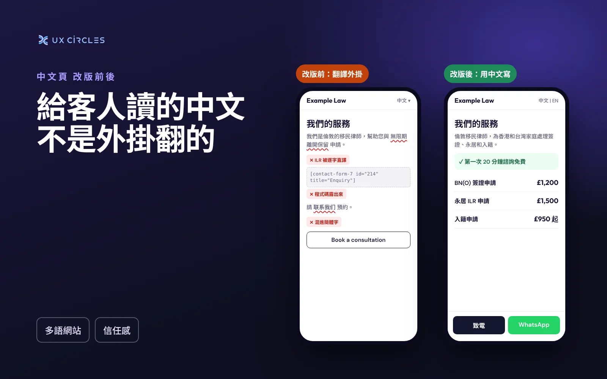

很多服務華語客人的事務所，會在網站上加一個翻譯按鈕。又快又便宜，看起來問題就解決了。但客人讀到的中文版，給人的印象常常和你想表達的差很多。

## 翻譯外掛常出的問題

- <b>法律和財務用語翻錯</b>：機器翻譯會選最常見的意思，而不是你們這一行的用法。像「conveyancing」或「indefinite leave to remain」這類詞，翻出來可能是香港或台灣客人完全看不懂的說法。
- <b>不該翻的也翻了</b>：人名、地址、帳號 ID 和表單欄位都可能被翻譯。我看過一個 WeChat ID 被翻成另一種語言的文字，客人照著複製，根本找不到這家事務所。
- <b>程式碼露出在頁面上</b>：外掛設定不正確時，訪客會在頁面最上方看到方括號包起來的程式碼，看起來就像網站壞了。
- <b>不一定能讓客人找到你</b>：有些外掛只在訪客的瀏覽器裡即時翻譯，搜尋引擎找不到任何中文頁面。客人用中文搜尋，可能永遠看不到你。
- <b>聽起來不像你</b>：客人在挑律師或會計師時，找的是值得信任的人。生硬的機器中文會讓人覺得這家事務所其實不太用中文工作，就算事實上不是如此。

## 什麼時候值得做真正的中文頁

不需要把整個網站都翻譯。先從決定客人會不會聯絡你的頁面開始：

1. <b>首頁</b>：你是誰、幫誰解決什麼問題、怎麼聯絡你。
2. <b>主要服務</b>：例如 BN(O) 簽證、物業買賣或報稅。
3. <b>收費</b>：用中文寫清楚的價格，最能建立信任。
4. <b>聯絡方式</b>：WhatsApp、電話和地址都要寫對。

這幾頁要用中文「寫」，而不是只用中文「翻」。用客人習慣的詞，例如香港客人說「按揭」，台灣客人說「房貸」。如果你的團隊會中文，上線前請他們每一頁都讀一遍。

## 五分鐘自我檢查

- [ ] 把網站切換到中文版。你願意直接把這一頁傳給客人嗎？
- [ ] 中文版裡的人名、電話號碼和各種 ID 還是正確的嗎？
- [ ] 有沒有露出程式碼或英文的預設文字？
- [ ] 用中文搜尋你的主要服務，網站會出現嗎？
- [ ] 中文版有清楚的聯絡方式嗎？

<i>林俊全（Chun-Chuan Lin）是有 14 年經驗的產品設計師，也是倫敦網頁設計工作室 UX CIRCLES 的創辦人。</i>
