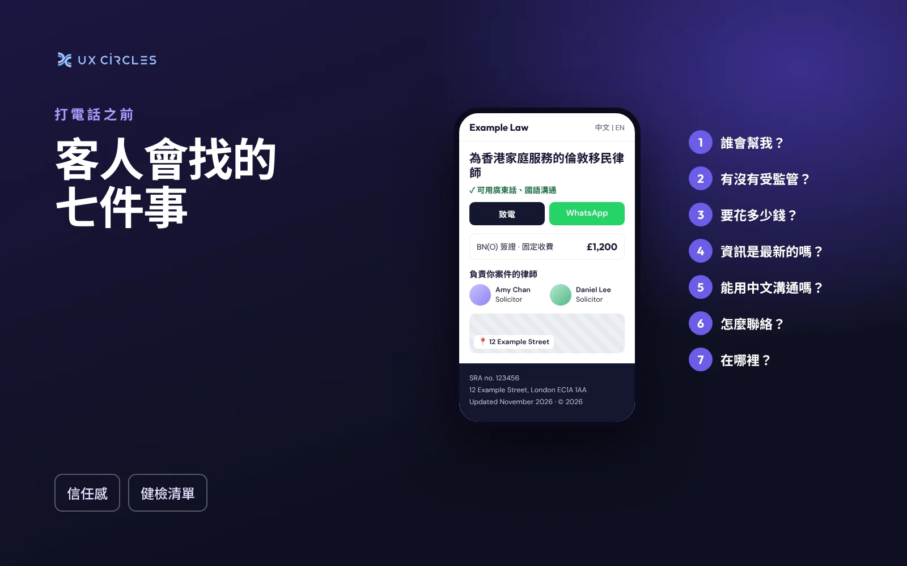

選律師、會計師或房貸顧問，是風險很高的決定。客人交給你的是簽證、積蓄，甚至是自己的房子。所以打電話之前，他們會先找能讓自己安心的訊號，通常是用手機、花一兩分鐘。

我過去幾年在財富管理平台做產品設計，那個領域裡，信任決定一切。小型事務所的網站也是一樣：客人不會一字一句讀，而是快速掃過，尋找幾個「可以放心聯絡」的線索。

## 客人會找的七件事

1. <b>誰會處理我的案子？</b> 負責的人的名字、照片和資格。只寫「我們的團隊」卻沒有任何人的臉，會讓人覺得很陌生。
2. <b>他們有受監管嗎？</b> 把監管機構和登記編號寫清楚，例如放在頁尾和「關於我們」頁面。客人未必懂細節，但他們會注意有沒有寫。
3. <b>大概要多少錢？</b> 清楚的收費，至少要說明怎麼收費。價格不公開，客人通常會往最壞的方向想。
4. <b>資訊是最新的嗎？</b> 已經取消的簽證名稱、舊的收費，或好幾年前的版權年份，都讓人覺得沒有人在管這個網站，甚至沒人在管這家事務所。
5. <b>可以用我的語言溝通嗎？</b> 如果你服務華語客人，就在第一屏說清楚，而且中文頁面要是真的、正確的中文。
6. <b>怎麼聯絡？</b> 一按就能用的「致電」或 WhatsApp 按鈕，還有容易找到的免費諮詢。
7. <b>他們在哪裡？</b> 每一頁都一致的地址，加上地圖。打算親自上門的客人，會想確定自己不會走錯地方。

## 放在哪裡

大部分的資訊，都應該在手機版首頁上，不用捲太多就看得到：

- 第一屏：你幫誰解決問題、使用哪些語言，加上聯絡按鈕
- 接著：主要服務，搭配一句收費說明
- 再來：負責的人，附照片和資格
- 頁尾：監管資訊、地址和聯絡方式

## 五分鐘自我檢查

請一位沒看過你網站的朋友用手機打開，給他一分鐘，然後問他：

- [ ] 誰會處理我的案子？
- [ ] 這家事務所有受監管嗎？
- [ ] 大概要多少錢？
- [ ] 可以用中文溝通嗎？
- [ ] 如果現在要聯絡，怎麼做？

他答不出來的問題，就是你該往頁面上方移的內容。

<i>林俊全（Chun-Chuan Lin）是有 14 年經驗的產品設計師，也是倫敦網頁設計工作室 UX CIRCLES 的創辦人。</i>
